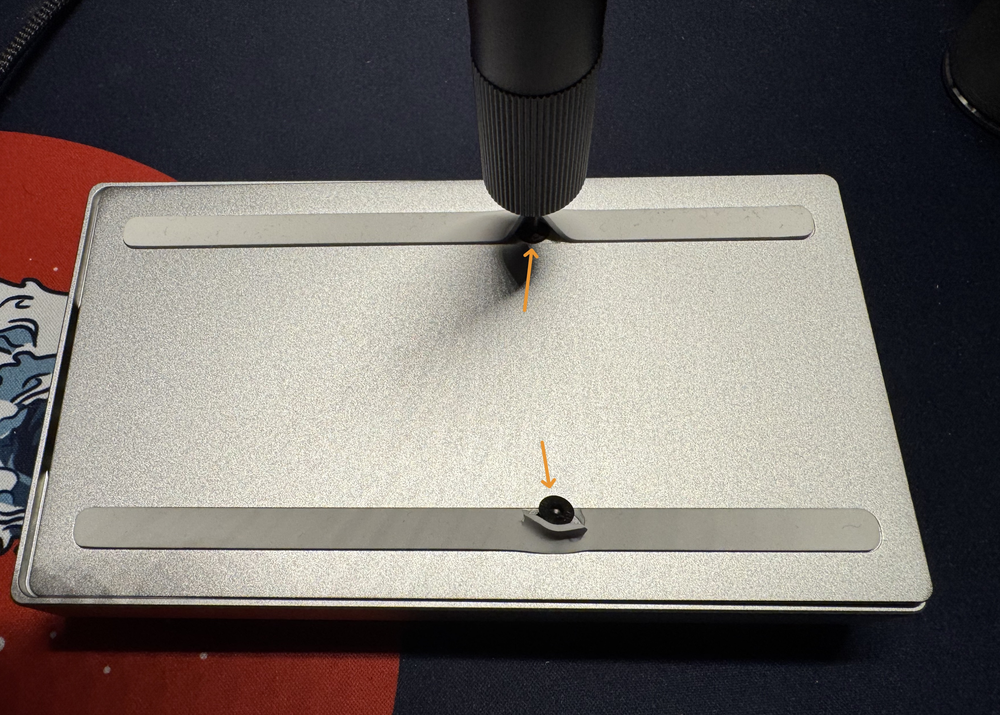
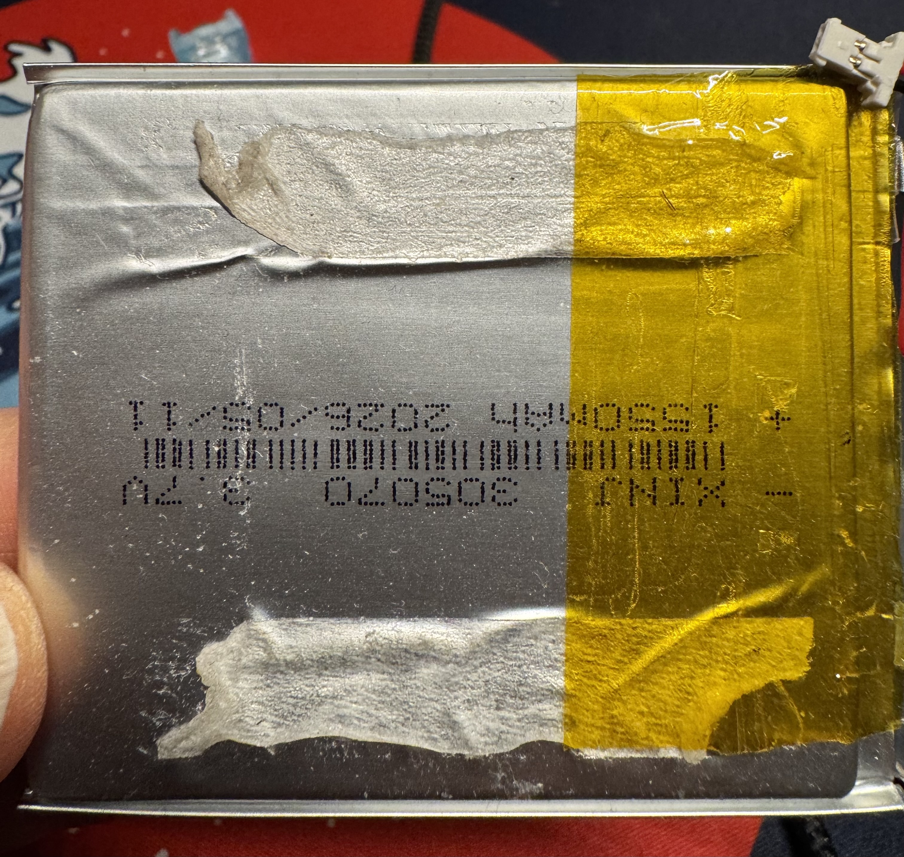
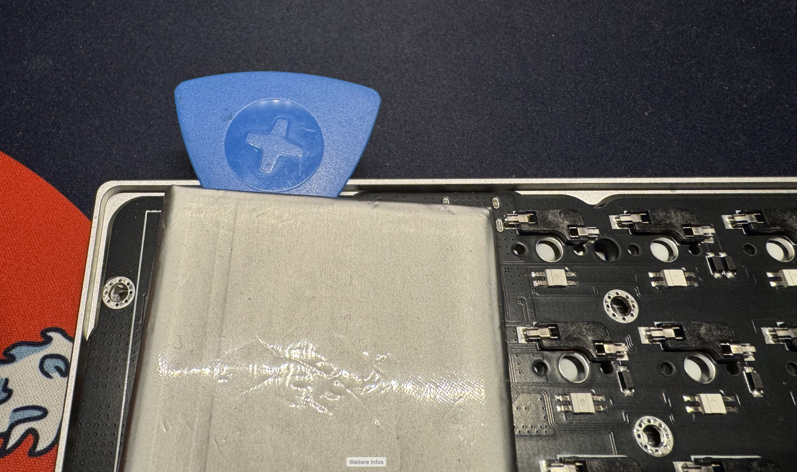
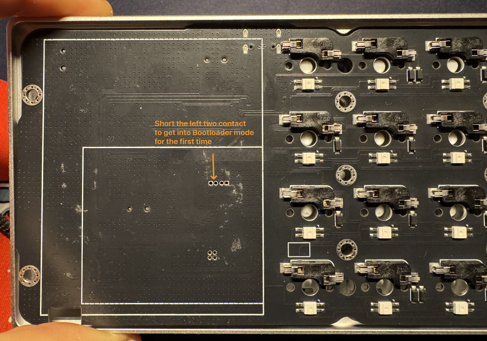

# BNK16-vial

A Vial firmware for the **Binepad BNK16** macropad (16 keys, 3 encoders, 4-position layer switch, Bluetooth, WCH CH585 chip). It replaces the stock QMK/VIA firmware, so you can remap everything live in [Vial](https://get.vial.today/), including shorcuts with modifiers, Tap Dance and Combos.

It's based on [NookCraftLab/ch585-qmk-vial](https://github.com/NookCraftLab/ch585-qmk-vial), which did the hard work of getting QMK running on the CH585.

<h2><font color="red">⚠️ WARNING</font></h2>

<font color="red">

**There is no way back to the stock firmware.** Flashing this overwrites Binepad's bootloader. I tried restoring the stock firmware and the board stayed dead: the only stock image you can download is built for a different hardware revision (I think), and the matching one is locked inside the read-protected stock bootloader. Unless Binepad hands out a working image, once you flash this, you stay on this firmware.

The board itself can't be bricked though. The real bootloader is in ROM, so you can always flash this or other firmwares again, if you have them.

</font>

## What works

Everything on the PCB:

- All 16 keys
- The three encoders, including the clicks on the two small ones
- The haptic motor (detents on the big knob, and you can tune the feel)
- The 4-position layer switch, inkl the status LED showing them in different colors
- Bluetooth with three devices, plus USB, selected by the slide switch
- Battery level reported to your computer over Bluetooth, deep sleep with the Bluetooth link kept when idle, and shutdown after a longer idle time

And a few things the stock firmware didn't have:

- **Bluetooth status on the keys:** the key bound to the active Bluetooth device lights blue when connected and blinks while pairing or searching
- **Only bound keys light up:** keys that have nothing assigned in Vial stay dark, so you can see your layout at a glance (there's a key to turn that off)
- **Deep sleep with the Bluetooth link kept:** when idle in the Bluetooth position the chip sleeps between radio events and stays connected, so the first key press after a break is typed right away without reconnecting. About 800 µA at the 15 ms interval and about 180 µA at the slow 100-120 ms interval, against 8.4 mA with the plain sleep before. A key, a knob or the slide switch wakes it, and the waking key is typed. After a long idle time the board shuts down completely (about 60 µA); a key then reboots and reconnects. Can be switched off at build time with `BNK16_DEEP_SLEEP` in `mcuconf.h`
- **Status LED** shows the current layer by colour (white, purple, orange, green), blinks blue while connecting, flashes red if a connection fails
- **Adjustable resolution for the big knob:** how many steps it sends per turn, changeable with two keys that go from green to red as you near the limit
- **Haptic settings** (frequency, length, brake pulse) changeable with keys and saved on the board

And because it's Vial:

- Live remapping, no flashing needed to change the keymap
- Shortcuts with Modifiers like Ctrl+S (its unfathomable to me that VIA doesnt support this (without tricks), this is such a basic feature), Tap Dance, Combos, Key Overrides, Macros, Mousekeys, etc
- All the modifier shortcuts (`LSA(KC__VOLUP)` and friends), media keys, mouse wheel
- RGB effects, configurable in Vial's Lighting tab

The Bluetooth, haptic, knob and reset keys are under **User** in Vial's keycode list.

## Default keymap

| Control | Default |
|---|---|
| Keys | Numpad on layer 0, Bluetooth and special functions on layer 3, everything else empty |
| Small left encoder | Brightness, click = PlayPause |
| Small right encoder | Page up/down, click = play/pause |
| Big knob | Mouse wheel |
| Layer switch | Layer 0-3 |

To pair a device, switch to layer 3 and hold BT1, BT2 or BT3 for 3 seconds. Tap it to switch between devices.

Vial is locked by default for the risky stuff (matrix tester, macros, bootloader key). To unlock, hold the top-left and top-right key when Vial asks.

Holding the top-left key while plugging in starts the update mode (see [Updates](#updates-drag-and-drop)), so don't hold it when you plug in for normal use.

## Flashing

The firmware comes with its own small bootloader. You install both once with `wchisp`. After that, updating means dragging a file onto a USB drive (uf2 mode).

Before any update, save your layout in Vial (File → Save current layout). A new build can reset the keymap stored on the board, so you can load it again afterwards.

### First install (once, with wchisp)

#### Opening the case

To be able to flash the new firmware including the bootloader it is needed to open up the case *once*. 

Move the rubber feed slightly to the side to reveal the two screws that hold the bottom panel. Be careful, the rubber is relatively delicate.

<p align="center">
  
</p>

To get into the bootloader we need to short two connections on the PCB. To get there we can either remove the glued battery or remove the PCB from the case. Removing the PCB is a little more involved (remove screws,remove small encoder knobs, remove all switches or pry the PCB from the switches, when putting together the knobs and switches need to be in the correct position to fit in) but safer.

To remove the battery use a plastic non-sharp object and slide it under the battery, carefully not to pinch or damage the battery. It is hold in place with two glue strips.

<p align="center">
  
  
</p>

Under the battery you can find the contacts to short here:

<p align="center">
  
</p>

You have to bridge those with tweezers for example WHILE connecting the USB. Then it is in bootloader mode.

#### Flashing

**wchisp** is a small command line tool for WCH chips. Get it from the [wchisp releases page](https://github.com/ch32-rs/wchisp/releases/tag/nightly) (there are builds for macOS, Linux and Windows). On Windows you might also need the Visual C++ runtime.

1. Get `bnk16-vX.Y.Z-full.bin` from this repo's Releases. If you build it yourself, it is `bnk16_full.bin` (see below).
2. Short the BOOT contact on the PCB (see picture above) while plugging in the USB cable. The board is now in ISP (bootloader) mode.
3. Flash right away, ISP mode times out quickly:

```bash
wchisp flash bnk16-v1.0.0-full.bin 
```
or if you only downloaded the tool and not installed it:
```bash
./wchisp flash bnk16-v1.0.0-full.bin 
```
(adjust for latest version number)

4. Replug the board, open the Vial app or <https://vial.rocks>, and it should show up as "Vialpad BNK16". On Linux you need the [udev rule from the Vial docs](https://get.vial.today/manual/linux-udev.html).

The same steps also work as a recovery if anything ever goes wrong. Don't run `wchisp config` unless you know why, it can erase the whole chip.

### Updates, after this firmware was flashed at least once (drag and drop)

1. Start the bootloader, one of these ways:
   - Slide the switch to USB, unplug the board, **hold the top-left key** and plug it back in.
   - Press a key that has `QK_BOOT` assigned in Vial. Vial must be unlocked to assign it.
2. A drive called **BNK16BOOT** appears.
3. Copy `bnk16-vX.Y.Z.uf2` from the Releases onto it. On macOS, drag it in Finder; `cp` in the Terminal sometimes fails on UF2 drives.
4. The board restarts with the new firmware by itself. Your computer may complain that the drive was not ejected properly; that is normal.

If a copy gets interrupted, nothing is lost: the board simply comes up as BNK16BOOT again and you copy the file once more. UF2 files whose family ID is neither this firmware’s (0x6B16C585) nor Binepad’s stock one (0x1AA143C7) are silently ignored (the copy looks successful, but nothing is flashed).

**Going back to stock:** the bootloader also accepts Binepad's own stock UF2 updates and starts them. Binepad's signature is not checked. This only helps with a stock UF2 that matches your PCB revision; the public 1.7.141 release does not run on my board, not sure if it is for another revision. If the stock firmware doesn't work, hold the top-left key while plugging in to get BNK16BOOT back, then copy our UF2 again. Stock's own update-mode key also leads back to BNK16BOOT. Expect the stored settings to reset when switching between the two.

## Building and changing the defaults

You only need this if you want to change something that Vial can't, like the default keymap, the layer colours or the haptics defaults.

You need [Docker](https://www.docker.com/products/docker-desktop/) (it carries the whole toolchain, about 8 GB on the first build) and Git.

```bash
git clone --recursive https://github.com/Technofrikus/BNK16-vial.git
```

```bash
cd BNK16-vial
```

```bash
docker run --rm --platform linux/amd64 -v "$PWD:/workspace" nookcraftlab/riscv:latest bash /workspace/firmware/ch585_v2/build-bnk16.sh
```

Everything ends up in `firmware/ch585_v2/build-bnk16/`: `bnk16.uf2` for drag-and-drop updates and `bnk16_full.bin` (bootloader + firmware) for `wchisp`. On Windows PowerShell use `${PWD}` instead of `$PWD`.

How releases are made is in [RELEASE.md](RELEASE.md).

### Where things are

Everything specific to the BNK16 lives in [firmware/ch585_v2/qmk_porting/keyboards/bnk16/](firmware/ch585_v2/qmk_porting/keyboards/bnk16/):

| File | What's in it |
|---|---|
| `keymaps/vial/keymap.c` | **The default keymap** and the custom keycodes |
| `vial.json` | The layout Vial shows and the names of the custom keycodes |
| `keymaps/vial/rules.cmake` | Which features are compiled in (Tap Dance, Combos, ...) |
| `qmk_config.h` | Pins, encoders, RGB, Vial options, haptic defaults |
| `bnk16.c` | Layer switch, big knob, haptics, status LED, USB/Bluetooth mode |
| `battery.c`, `power_management.c` | Battery reading, deep sleep and shutdown |
| `mcuconf.h` | Chip options, including the `BNK16_DEEP_SLEEP` switch |

The rest of the repo:

```
firmware/ch585_v2/
  build-bnk16.sh          build script
  bootloader/             UF2 bootloader and flash layout (layout.cmake)
  qmk_firmware/           QMK with Vial (submodule, unmodified)
  qmk_porting/            the CH585 port: board targets, drivers, Bluetooth
  user/usb/               USB descriptors and driver
docs/bnk16/               pin map and development notes (deep sleep: PROJECT_NOTES.md, PHASE47_HANDOVER.md)
```

If you change `keymap.c`, keep the order of the custom keycodes in sync with `customKeycodes` in `vial.json`.

## Versions

| Part | Version |
|---|---|
| Vial | Identical in `quantum/`, `tmk_core/` and `drivers/` to [vial-kb/vial-qmk](https://github.com/vial-kb/vial-qmk) at `dd43959a` (2026-07-27), the newest commit when checked on 2026-10-30. Vial protocol 6 |
| QMK | The base of that vial-qmk: last merged from QMK on 2025-06-21 (breaking-changes release `20250525`) |
| Submodule | [NookCraftLab/qmk_firmware](https://github.com/NookCraftLab/qmk_firmware) `49a7a153`, a copy of vial-qmk without Git history |
| WCH BLE library | `CH585_BLE_LIB_V1.5.0928`, closed source |
| Toolchain | WCH GCC 12.2 in `nookcraftlab/riscv:latest` |

## License

GPLv3, see [LICENSE](LICENSE), same as QMK and the upstream port.

The exception is `libCH58xBLE.a`, WCH's Bluetooth library, which is closed source and only shipped as a binary. See [docs/LICENSE_NOTICE.md](docs/LICENSE_NOTICE.md).
