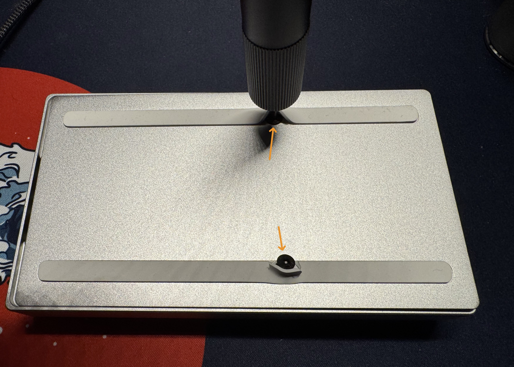
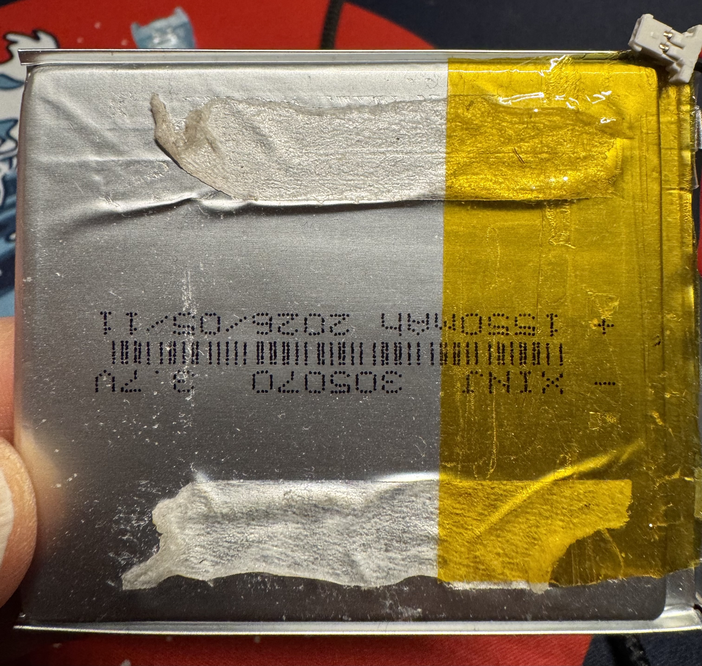
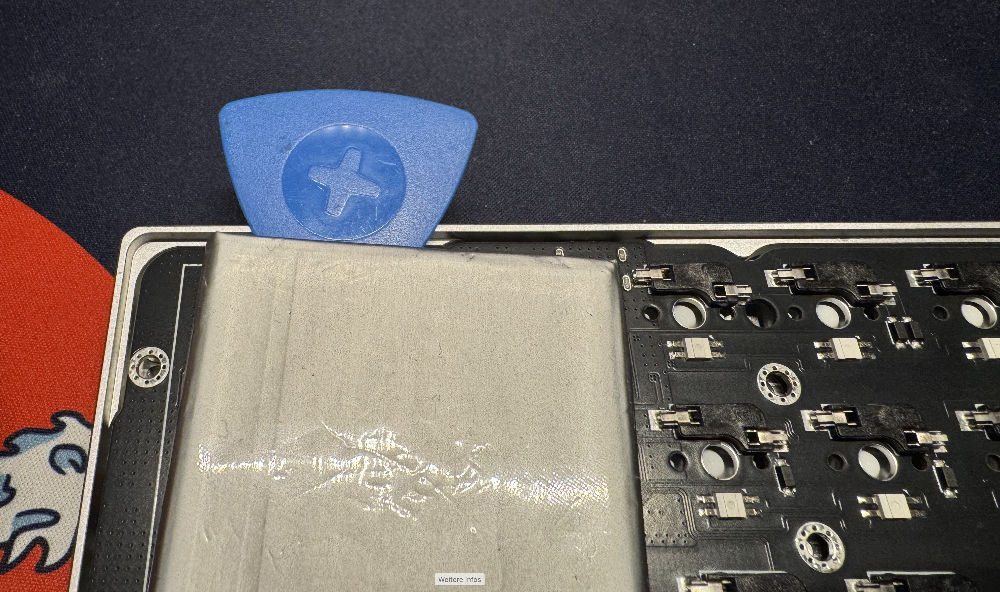
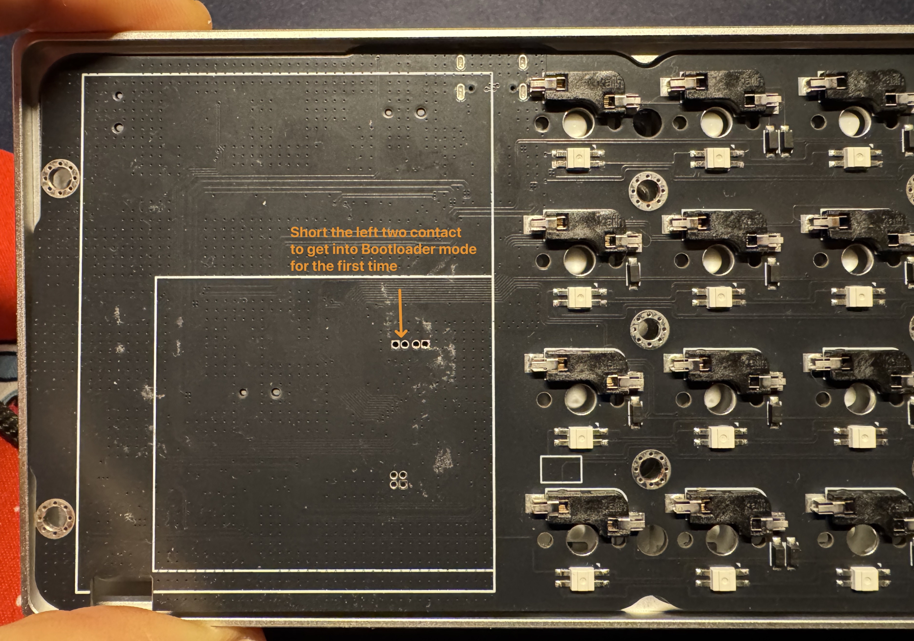

# BNK16-vial

A Vial firmware for the **Binepad BNK16** macropad (16 keys, 3 encoders, 4-position layer switch, Bluetooth, WCH CH585 chip). It replaces the stock QMK/VIA firmware, so you can remap everything live in [Vial](https://get.vial.today/), including shorcuts with modifiers, Tap Dance and Combos.

It's based on [NookCraftLab/ch585-qmk-vial](https://github.com/NookCraftLab/ch585-qmk-vial), which did the hard work of getting QMK running on the CH585.

<h2><font color="red">⚠️ WARNING</font></h2>

<font color="red">

**There is no way back to the stock firmware.** Flashing this overwrites Binepad's bootloader. I tried restoring the stock firmware and the board stayed dead: the only stock image you can download is built for a different hardware revision (I think), and the matching one is locked inside the read-protected stock bootloader. Unless Binepad hands out a working image, once you flash this, you stay on this firmware.

**Check your PCB first.** Open the case and compare your board with these photos ([top side](pictures/pcb-top.jpg), [bottom side with the hot-swap sockets](pictures/pcb-bottom.jpg)). Only flash if it looks the same; a different hardware revision may not work with this firmware.

The board itself can't be bricked though. The real bootloader is in ROM, so you can always flash this or other firmwares again, if you have them.

</font>

## What works

Everything on the PCB:

- All 16 keys
- The three encoders, including the clicks on the two small ones
- The haptic motor (detents on the big knob, and you can tune the feel)
- The 4-position layer switch, inkl the status LED showing them in different colors
- Bluetooth with three devices, plus USB, selected by the slide switch
- Battery level reported to your computer over Bluetooth, deep sleep with the Bluetooth link kept when idle, and shutdown after a longer idle time

And a few things the stock firmware didn't have:

- **Bluetooth status on the keys:** the key bound to the active Bluetooth device lights blue when connected and blinks while pairing or searching
- **Only bound keys light up:** keys that have nothing assigned in Vial stay dark, so you can see your layout at a glance (there's a key to turn that off)
- **Deep sleep with the Bluetooth link kept:** when you leave the board alone in the Bluetooth position, it goes to sleep but stays connected, so the first key after a break is typed right away. After a few hours it switches itself off completely, and a key press starts it again. More in [Saving power](#saving-power)
- **Status LED** shows the current layer by colour (white, purple, orange, turquoise), blinks blue while connecting, flashes blue and red in turn if a connection fails
- **Low battery warning:** below 20 % the status LED flashes red three times at the first key after a wake-up, then at most every 5 minutes (every minute below 10 %). Before the board shuts down on an empty battery the LED is red for 2 s; after such a shutdown it only starts again once the battery has been charged (it shows the red and switches off again until then)
- **Battery level on a key:** `BATTERY_SHOW` lights the status LED for 3 s in green, yellow-green, yellow, orange or red, in 20 % steps
- **Adjustable resolution for the big knob:** how many steps it sends per turn, changeable with two keys
- **Haptic settings** (frequency, length, brake pulse) changeable with keys and saved on the board
- **Adjustable sleep time:** how long the board stays in light sleep before the deep sleep, for people who use the small right encoder a lot, see [Saving power](#saving-power)
- **Settings keys show where you are:** the keys for the big knob, the haptics frequency and length and the sleep time light from green to red as you near the end of their range. **Type Current Settings** types all settings as text, so you can look them up

And because it's Vial:

- Live remapping, no flashing needed to change the keymap
- Shortcuts with Modifiers like Ctrl+S (its unfathomable to me that VIA doesnt support this (without tricks), this is such a basic feature), Tap Dance, Combos, Key Overrides, Macros, Mousekeys, etc
- All the modifier shortcuts (`LSA(KC__VOLUP)` and friends), media keys, mouse wheel
- RGB effects, configurable in Vial's Lighting tab

The Bluetooth, haptic, knob, battery, sleep time and reset keys, and Type Current Settings, are under **User** in Vial's keycode list. What each one does is in [User keys](#user-keys).

## Default keymap

| Control | Default |
|---|---|
| Keys | Numpad on layer 0, the board settings on layer 3 (see [User keys](#user-keys)), layers 1 and 2 empty |
| Small left encoder | Brightness, click = PlayPause |
| Small right encoder | Page up/down, click = play/pause |
| Big knob | Mouse wheel |
| Layer switch | Layer 0-3 |

To pair a device, switch to layer 3 and hold BT1, BT2 or BT3 for 3 seconds. Tap it to switch between devices.

Vial is locked by default for the risky stuff (matrix tester, macros, bootloader key). To unlock, hold the top-left and top-right key when Vial asks.

Holding the top-left key while plugging in starts the update mode (see [Updates](#updates-drag-and-drop)), so don't hold it when you plug in for normal use.

## User keys

Layer 3 is full of keys that change settings of the board itself. You find all of them under **User** in Vial, so you can also put them anywhere else. This is the default layer 3, and the list below explains every user key, also the two that are not on it:

| | | | |
|---|---|---|---|
| BT1 | BT2 | BT3 | BT Clear |
| Sleep Time Shorter | Sleep Time Longer | Type Current Settings | LED Mask |
| Haptics Freq Down | Haptics Freq Up | Haptics Shorter | Haptics Longer |
| Knob Lower Resolution | Knob Higher Resolution | Haptics Reset | Battery |

- **BT1, BT2, BT3:** tap to switch to that device, hold for 3 seconds to pair it. They light blue when connected.
- **BT Clear:** a single tap forgets all paired devices at once. Every device has to pair again. Careful, there is no question before it happens.
- **Sleep Time Shorter / Longer:** how long the board waits before deep sleep. Only interesting if you use the small right encoder a lot, see [Saving power](#saving-power). The two keys light from green to red, like the knob keys below.
- **Type Current Settings:** types all settings you can change as one line of text, for example `Sleep time 5 min, Haptic freq 128, Haptic length 2, Brake on, Knob steps 2, Unassigned LEDs off`, wherever your cursor is. Handy if you changed things and forgot what you set.
- **LED Mask:** by default only keys with something assigned light up. This key switches that: all keys light, or back to only the assigned ones.
- **Haptics Freq Down / Up:** how fast the motor buzzes, which changes how the buzz feels. Every press gives a test buzz, and the two keys light from green to red as you near the limit.
- **Haptics Shorter / Longer:** how long one buzz of the motor lasts, again with a test buzz and the green to red colours.
- **Haptics Brake Pulse On/Off** (not on the default map): adds a short counter pulse after each buzz that stops the motor faster. The key lights red when it is on and green when it is off.
- **Knob Lower / Higher Resolution:** how many steps the big knob needs for one key press, so how many key presses and buzzes you get per turn. Higher means more per turn. The two keys light from green to red, so you see how far you can still go in that direction.
- **Haptics Reset:** puts the haptics and the big knob back to their defaults. It does not touch the sleep time or the LED mask.
- **Battery:** the status LED shows the battery level for 3 seconds, from green (full) over yellow and orange to red (almost empty). In the USB position it does nothing, because the slide switch cuts the battery there.
- **Factory Reset** (not on the default map): hold it for 5 seconds to forget all paired devices and reset all settings, then the board restarts.

## Saving power

In the Bluetooth position the board looks after the battery by itself. In the USB position it never sleeps, because the slide switch cuts the battery there.

1. **Awake:** while you use it.
2. **Light sleep:** 15 seconds after your last input the LEDs go off. The board is still fully awake, so every key and every knob reacts immediately.
3. **Deep sleep:** after the sleep time (5 minutes by default) the board really sleeps, but the Bluetooth connection stays up. Your first key after a break is typed right away.
4. **Off:** 4 hours after your last input the board switches off completely. A key press starts it again and it reconnects, but that key press is not typed.

With a USB cable in and a computer awake on the other end, the board doesn't go to deep sleep or switch off.

In deep sleep, every key, the small left encoder, the big knob and the slide switch wake the board. Moving the layer switch does too, but it can take a moment. **The small right encoder can't wake the board.** The chip has no wake-up on those two pins and I can't change that. If you turn it after a break, nothing happens until something else has woken the board (a click on it is enough). The same is true when the board is switched off.

### Why change the sleep time?

Only for one reason: you use the small right encoder a lot. During light sleep it works, in deep sleep it doesn't. A longer sleep time keeps the board in light sleep longer, so the encoder stays usable, but light sleep uses a lot more power than deep sleep (about 40 times as much). If you don't care about that encoder, the default is fine, and if you want the maximum battery life, make it shorter.

### The keys

You find them under **User** in Vial:

- **Sleep Time Shorter / Sleep Time Longer:** one step per press. The steps are 1 second, 1, 5 (default), 10, 20, 30, 60 and 120 minutes. The board buzzes once per press, like the haptics keys, and the two keys light from green (room left) to red (end of the range). To see the current value, use Type Current Settings under [User keys](#user-keys).

The setting is saved on the board and survives updates. A factory reset puts it back to 5 minutes. A change counts from the next time the board falls asleep.

### Which setting?

How much battery life you lose depends on how often you take a break that is longer than the sleep time. These are rough guesses for 5 hours of use per day with 6 such breaks:

| Sleep time | Battery lasts about |
|---|---|
| 1 second | 15 days |
| 1 minute | 15 days |
| 5 minutes (default) | 14 days |
| 10 minutes | 14 days |
| 20 minutes | 13 days |
| 30 minutes | 12 days |
| 60 minutes | 10 days |
| 120 minutes | 7 days |

With fewer breaks, or breaks shorter than the sleep time, you lose less. With your LEDs brighter than the default, everything gets shorter, but the differences between the rows stay about the same. Overnight and weekends cost nothing extra, because by then the board is in deep sleep or off.

## Flashing

The firmware comes with its own small bootloader. You install both once with `wchisp`. After that, updating means dragging a file onto a USB drive (uf2 mode).

An update keeps the keymap, macros and settings stored on the board: they live in a separate part of the flash that flashing does not touch, and the firmware only resets them when its Vial build ID differs from the one stored there. That ID is fixed now and is only changed for a release whose stored layout would no longer fit; the release notes will say so. The first update from a build made before the ID was fixed resets the keymap once. Saving your layout in Vial before an update (File → Save current layout) is still a good habit, so you can load it again if that happens.

### First install (once, with wchisp)

#### Opening the case

To be able to flash the new firmware including the bootloader it is needed to open up the case *once*. 

Move the rubber feed slightly to the side to reveal the two screws that hold the bottom panel. Be careful, the rubber is relatively delicate.

<p align="center">
  
</p>

To get into the bootloader we need to short two connections on the PCB. To get there we can either remove the glued battery or remove the PCB from the case. Removing the PCB is a little more involved (remove screws,remove small encoder knobs, remove all switches or pry the PCB from the switches, when putting together the knobs and switches need to be in the correct position to fit in) but safer.

To remove the battery use a plastic non-sharp object and slide it under the battery, carefully not to pinch or damage the battery. It is hold in place with two glue strips.

<p align="center">
  
  
</p>

Under the battery you can find the contacts to short here:

<p align="center">
  
</p>

You have to bridge those with tweezers for example WHILE connecting the USB. Then it is in bootloader mode.

#### Flashing

**wchisp** is a small command line tool for WCH chips. Get it from the [wchisp releases page](https://github.com/ch32-rs/wchisp/releases/tag/nightly) (there are builds for macOS, Linux and Windows). On Windows you might also need the Visual C++ runtime.

1. Get `bnk16-vX.Y.Z-full.bin` from this repo's Releases. If you build it yourself, it is `bnk16_full.bin` (see below).
2. Short the BOOT contact on the PCB (see picture above) while plugging in the USB cable. The board is now in ISP (bootloader) mode.
3. Flash right away, ISP mode times out quickly:

```bash
wchisp flash bnk16-v1.0.0-full.bin 
```
or if you only downloaded the tool and not installed it:
```bash
./wchisp flash bnk16-v1.0.0-full.bin 
```
(adjust for latest version number)

4. Replug the board, open the Vial app or <https://vial.rocks>, and it should show up as "Vialpad BNK16". On Linux you need the [udev rule from the Vial docs](https://get.vial.today/manual/linux-udev.html).

The same steps also work as a recovery if anything ever goes wrong. Don't run `wchisp config` unless you know why, it can erase the whole chip.

### Updates, after this firmware was flashed at least once (drag and drop)

1. Start the bootloader, one of these ways:
   - Slide the switch to USB, unplug the board, **hold the top-left key** and plug it back in.
   - Press a key that has `QK_BOOT` assigned in Vial. Vial must be unlocked to assign it.
2. A drive called **BNK16BOOT** appears.
3. Copy `bnk16-vX.Y.Z.uf2` from the Releases onto it. On macOS, drag it in Finder; `cp` in the Terminal sometimes fails on UF2 drives.
4. The board restarts with the new firmware by itself. Your computer may complain that the drive was not ejected properly; that is normal.

If a copy gets interrupted, nothing is lost: the board simply comes up as BNK16BOOT again and you copy the file once more. UF2 files whose family ID is neither this firmware’s (0x6B16C585) nor Binepad’s stock one (0x1AA143C7) are silently ignored (the copy looks successful, but nothing is flashed).

**Going back to stock:** the bootloader also accepts Binepad's own stock UF2 updates and starts them. Binepad's signature is not checked. This only helps with a stock UF2 that matches your PCB revision; the public 1.7.141 release does not run on my board, not sure if it is for another revision. If the stock firmware doesn't work, hold the top-left key while plugging in to get BNK16BOOT back, then copy our UF2 again. Stock's own update-mode key also leads back to BNK16BOOT. Expect the stored settings to reset when switching between the two.

## Building and changing the defaults

You only need this if you want to change something that Vial can't, like the default keymap, the layer colours or the haptics defaults.

You need [Docker](https://www.docker.com/products/docker-desktop/) (it carries the whole toolchain, about 8 GB on the first build) and Git.

```bash
git clone --recursive https://github.com/Technofrikus/BNK16-vial.git
```

```bash
cd BNK16-vial
```

```bash
docker run --rm --platform linux/amd64 -v "$PWD:/workspace" nookcraftlab/riscv:latest bash /workspace/firmware/ch585_v2/build-bnk16.sh
```

Everything ends up in `firmware/ch585_v2/build-bnk16/`: `bnk16.uf2` for drag-and-drop updates and `bnk16_full.bin` (bootloader + firmware) for `wchisp`. On Windows PowerShell use `${PWD}` instead of `$PWD`.

How releases are made is in [RELEASE.md](RELEASE.md).

### Where things are

Everything specific to the BNK16 lives in [firmware/ch585_v2/qmk_porting/keyboards/bnk16/](firmware/ch585_v2/qmk_porting/keyboards/bnk16/):

| File | What's in it |
|---|---|
| `keymaps/vial/keymap.c` | **The default keymap** and the custom keycodes |
| `vial.json` | The layout Vial shows and the names of the custom keycodes |
| `keymaps/vial/rules.cmake` | Which features are compiled in (Tap Dance, Combos, ...) |
| `rules.cmake` | Hardware switches and `VIAL_BUILD_ID` (see below) |
| `qmk_config.h` | Pins, encoders, RGB, Vial options, haptic defaults |
| `bnk16.c` | Layer switch, big knob, haptics, status LED, USB/Bluetooth mode |
| `battery.c`, `power_management.c` | Battery reading, deep sleep and shutdown |
| `mcuconf.h` | Chip options, including the `BNK16_DEEP_SLEEP` switch and the list of test switches |
| `bnk16_sleep_diag.c` | Deep sleep diagnostics, only compiled into test builds |

The rest of the repo:

```
firmware/ch585_v2/
  build-bnk16.sh          build script
  bootloader/             UF2 bootloader and flash layout (layout.cmake)
  qmk_firmware/           QMK with Vial (submodule, unmodified)
  qmk_porting/            the CH585 port: board targets, drivers, Bluetooth
  user/usb/               USB descriptors and driver
docs/bnk16/               pin map and development notes (deep sleep: PROJECT_NOTES.md, PHASE47_HANDOVER.md)
```

If you change `keymap.c`, keep the order of the custom keycodes in sync with `customKeycodes` in `vial.json`.

The board only loads the default keymap from `keymap.c` when the keymap stored on it is reset. To make your build do that, count up `VIAL_BUILD_ID` in `rules.cmake` (or reset the keymap from Vial). Count it up as well whenever you change the matrix, the layout in `vial.json`, the number of layers or the Vial tap dance, combo or key override counts, because a stored keymap from before would no longer fit.

## Versions

| Part | Version |
|---|---|
| Vial | Identical in `quantum/`, `tmk_core/` and `drivers/` to [vial-kb/vial-qmk](https://github.com/vial-kb/vial-qmk) at `dd43959a` (2026-07-27), the newest commit when checked on 2026-10-30. Vial protocol 6 |
| QMK | The base of that vial-qmk: last merged from QMK on 2025-06-21 (breaking-changes release `20250525`) |
| Submodule | [NookCraftLab/qmk_firmware](https://github.com/NookCraftLab/qmk_firmware) `49a7a153`, a copy of vial-qmk without Git history |
| WCH BLE library | `CH585_BLE_LIB_V1.5.0928`, closed source |
| Toolchain | WCH GCC 12.2 in `nookcraftlab/riscv:latest` |

## License

GPLv3, see [LICENSE](LICENSE), same as QMK and the upstream port.

The exception is `libCH58xBLE.a`, WCH's Bluetooth library, which is closed source and only shipped as a binary. See [docs/LICENSE_NOTICE.md](docs/LICENSE_NOTICE.md).
